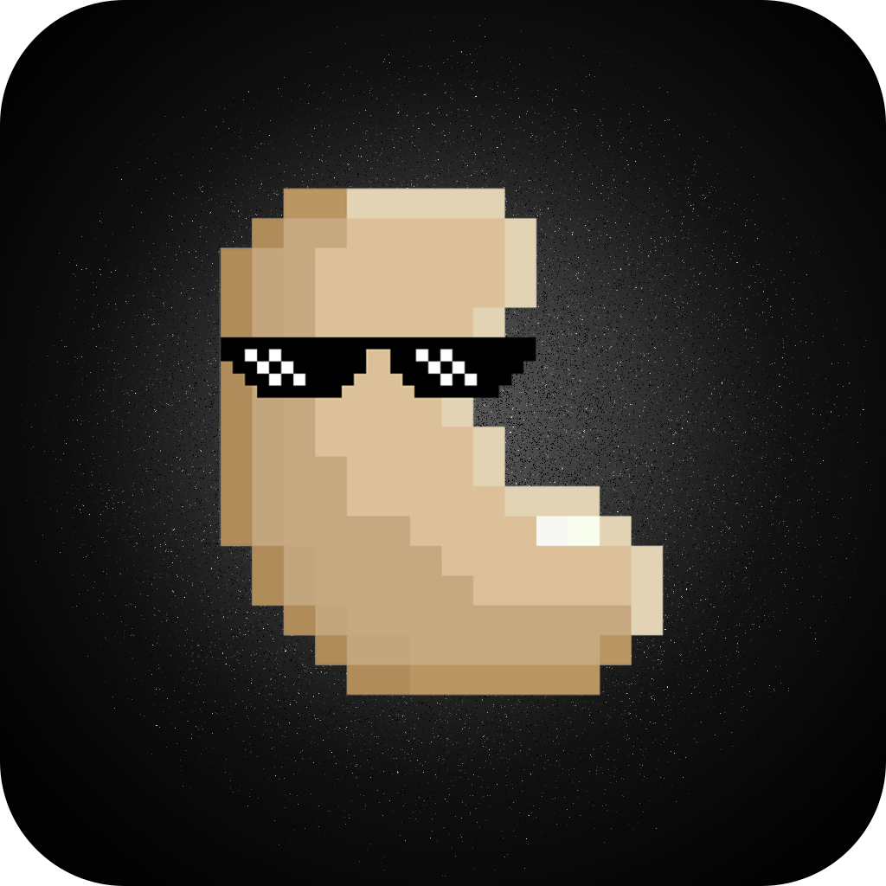
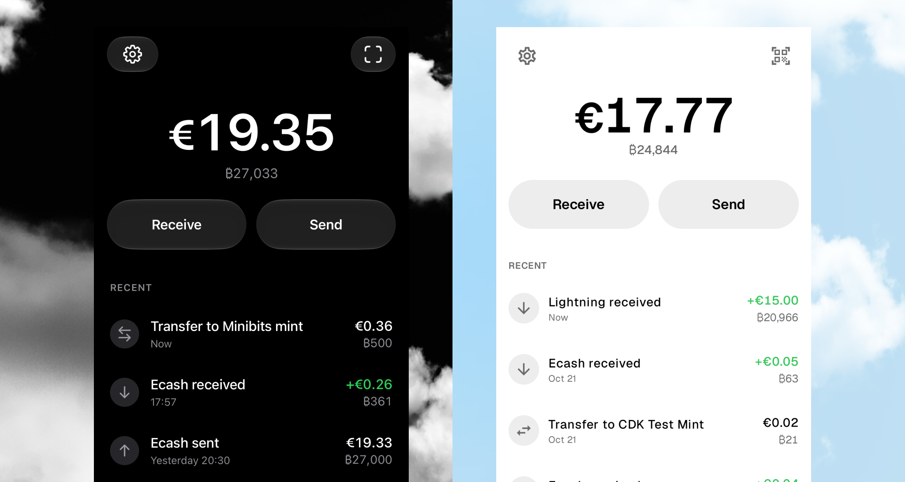

<div align="center">

  

  <h1>Cashu Me</h1>

  <p><strong>Bitcoin ecash. Native on iOS and Android.</strong></p>

  <p>
    Send and receive private ecash payments, pay over Lightning,<br>
    and manage your mints in one open-source wallet.
  </p>

  <p>
    <a href="https://github.com/cashubtc/wallet/releases/latest"><strong>Download for Android</strong></a>
    &nbsp;·&nbsp;
    <a href="ios/README.md#building">Build for iOS</a>
    &nbsp;·&nbsp;
    <a href="#features">Features</a>
    &nbsp;·&nbsp;
    <a href="#development">Development</a>
  </p>

  

</div>

## Everyday payments, with ecash

[Cashu](https://cashu.space) is a Bitcoin ecash protocol. A mint holds bitcoin
and issues ecash that you keep in your wallet. Blind signatures let you make
ecash payments without the mint learning who pays whom.

Cashu Me brings that to iPhone and Android, with native interfaces built
in SwiftUI and Jetpack Compose. Receive your first sats, share ecash as a QR
code or text, and move between ecash and Lightning without running a node.

Ecash depends on the mint holding and redeeming its bitcoin backing. Choose
mints you trust; a seed phrase cannot protect you from a mint losing funds
or going offline.

## Features

- **Send ecash.** Share Cashu tokens as QR codes or text. Lock tokens to a
  recipient's key with P2PK.
- **Pay with Lightning.** Send and receive with BOLT11 invoices and BOLT12
  offers, and pay Lightning addresses.
- **Use on-chain Bitcoin.** Send to and receive from Bitcoin addresses through
  mints that support it.
- **Receive with Cashu Requests.** Share reusable payment requests and receive
  ecash over Nostr relays.
- **Manage multiple mints.** Add mints by URL or QR code, discover public mints,
  see each balance, and transfer funds between mints.
- **Go contactless.** Send and receive ecash using NFC on supported devices.
- **Connect other apps.** Use Nostr Wallet Connect with scoped permissions.
- **Back up and restore.** Back up your seed phrase, restore your wallet, and
  recover a deposit using its mint quote ID. Protect access with App Lock.

Payment methods and fees depend on your mint. NFC availability depends on the
device and platform. See the [deposit recovery guide](docs/product/deposit-recovery.md)
for recovery requirements and supported payment methods.

## Get the wallet

| Platform | Install | Requirements |
| --- | --- | --- |
| Android | Download the APK from the [latest release](https://github.com/cashubtc/wallet/releases/latest) | Android 8.0+ |
| iOS | [Build with Xcode](ios/README.md#building) | iOS 18+ |

Release notes and earlier downloads are on the
[releases page](https://github.com/cashubtc/wallet/releases).

## Development

Both apps use the [Cashu Dev Kit](https://github.com/cashubtc/cdk) through
native bindings. Shared product and design guidance lives in
[`docs/product/`](docs/product/).

| Directory | Contents |
| --- | --- |
| [`ios/`](ios/) | SwiftUI app, Xcode project, and iOS tests |
| [`android/`](android/) | Kotlin / Jetpack Compose app and Android tests |
| [`docs/screenshots/`](docs/screenshots/) | App screenshots from both platforms |
| [`CI/`](CI/) | Local Nutshell and CDK mints for integration tests |

### Building

iOS (requires Xcode with the iOS 18+ SDK):

```sh
cd ios
xcodebuild -project CashuWallet.xcodeproj \
  -scheme CashuWallet \
  -destination 'platform=iOS Simulator,name=iPhone 17 Pro' \
  build
```

Android (requires JDK 17 and an Android SDK; point `local.properties` or
`ANDROID_HOME` at it):

```sh
cd android
./gradlew --no-daemon :app:assembleDebug
```

### Testing

Unit tests:

```sh
# iOS
cd ios && xcodebuild test -project CashuWallet.xcodeproj -scheme CashuWallet \
  -destination 'platform=iOS Simulator,name=iPhone 17 Pro' \
  -only-testing:CashuWalletTests

# Android
cd android && ./gradlew --no-daemon :app:testDebugUnitTest
```

Integration tests run the apps against real mint implementations started
locally — see [`CI/README.md`](CI/README.md) for the full setup:

```sh
./CI/setup-nutshell.sh && ./CI/start-nutshell.sh
./CI/setup-cdk.sh && ./CI/start-cdk.sh
```

## Contributing

[Report a bug](https://github.com/cashubtc/wallet/issues), suggest an improvement,
or open a pull request. For interface changes, consider both iOS and Android
and include screenshots of the affected flows.

Platform setup: [iOS](ios/README.md) · [Android](android/README.md).

## Security

Report vulnerabilities privately using the contact in [SECURITY.md](SECURITY.md).

## License

[MIT](LICENSE)
